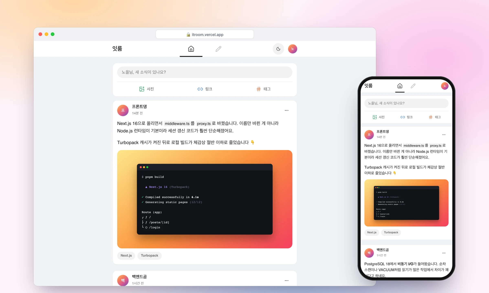
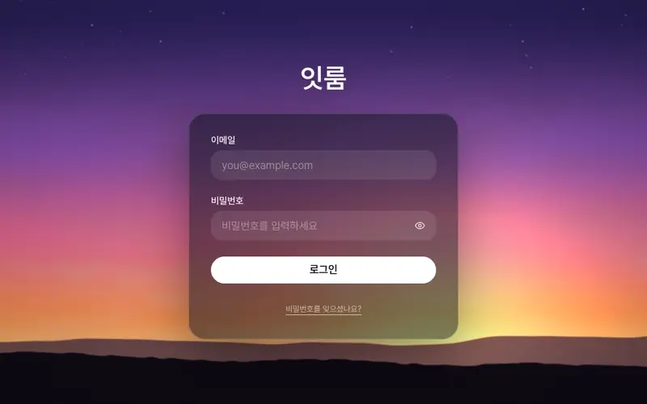
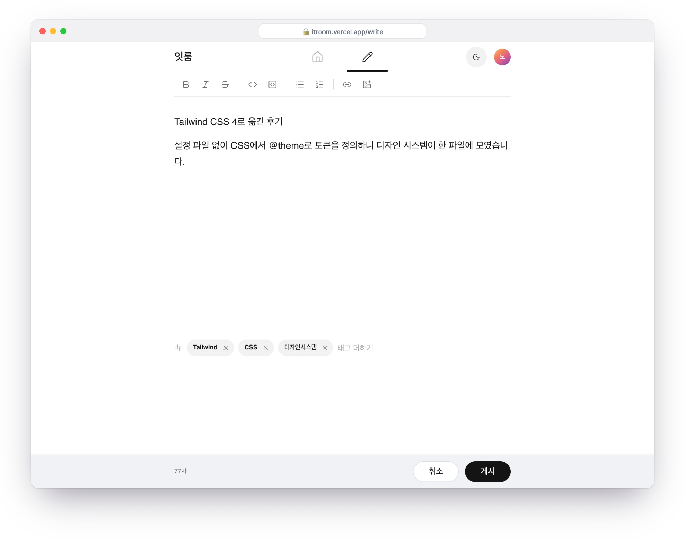
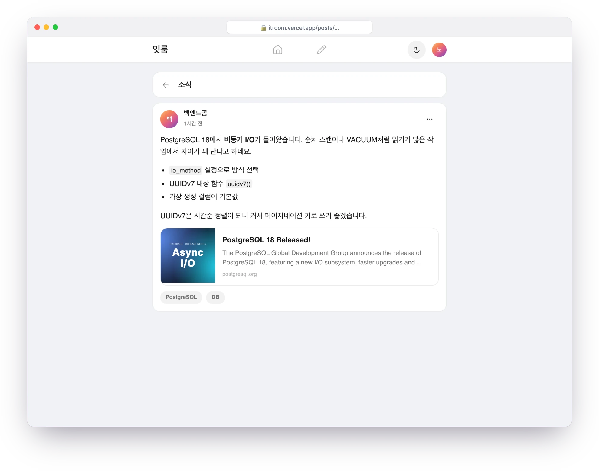
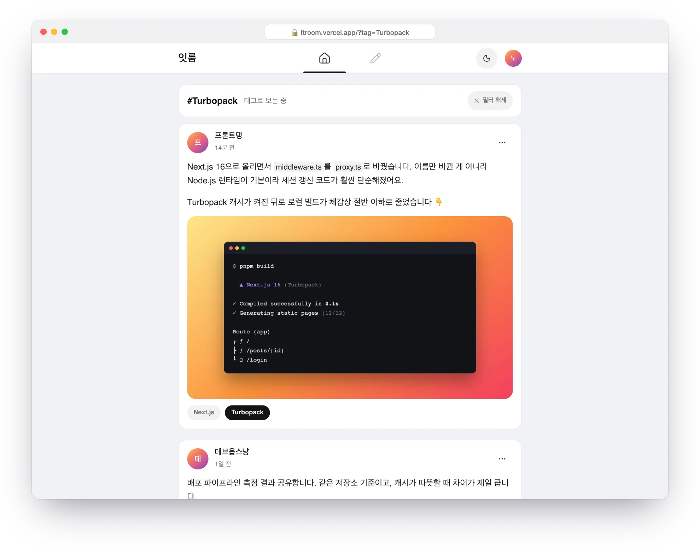
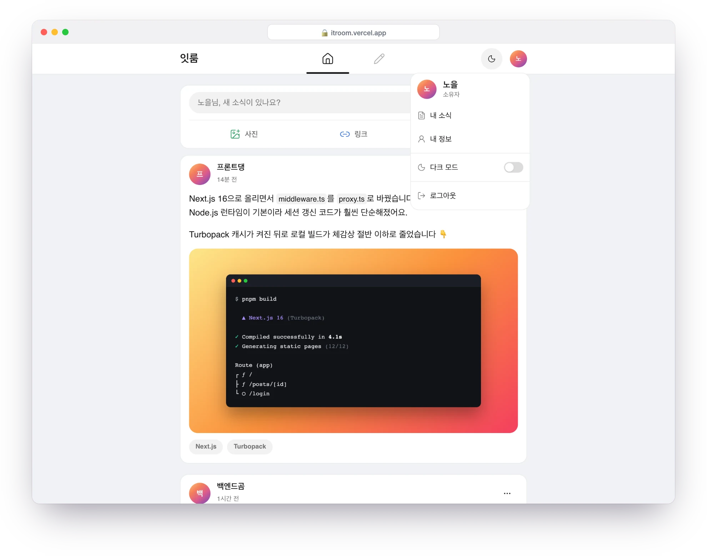
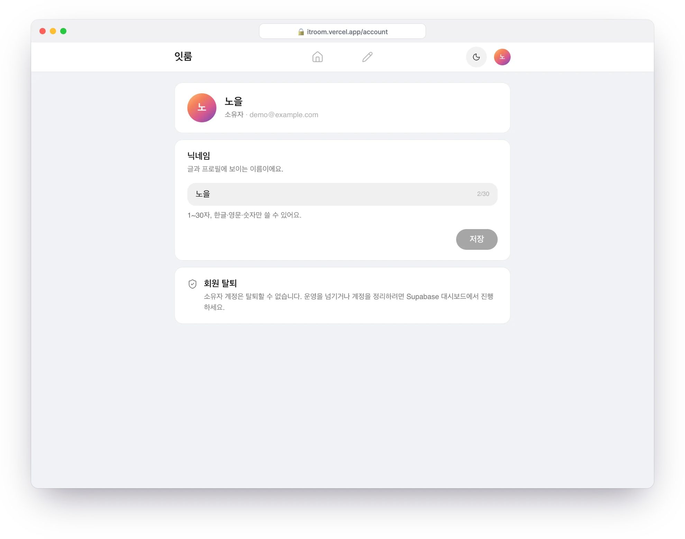
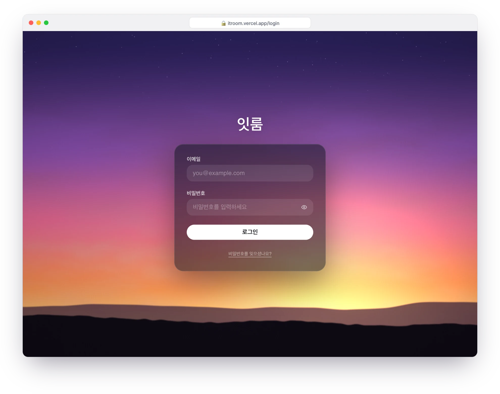
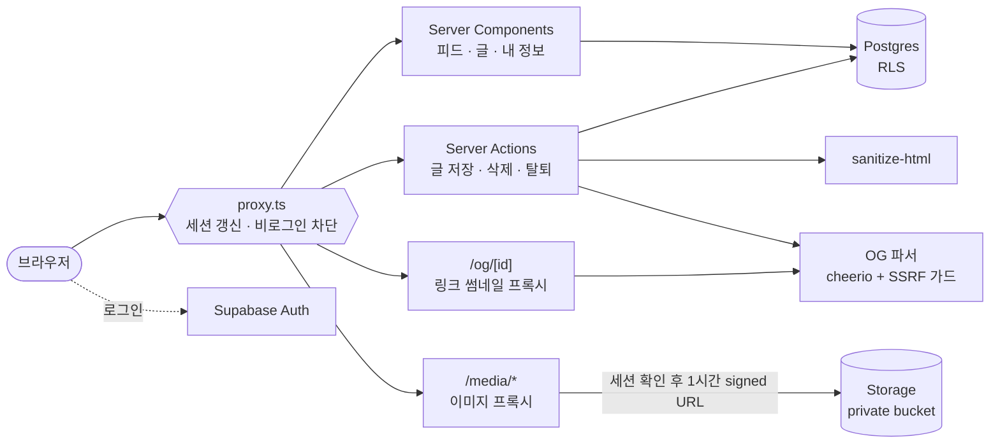

<div align="center">


# 잇룸 <sub><sup>it room</sup></sub>

**초대받은 사람만 들어와 IT 소식을 짧은 글로 나누는 폐쇄형 SNS**

공개 가입 없음 · 검색 노출 없음 · 쓰기 편한 에디터

<p>
  
  
  
  
  
  
  
  
</p>

<picture>
  <source media="(prefers-color-scheme: dark)" srcset="docs/readme/hero-dark.webp" />
  
</picture>

<sub>GitHub 테마에 따라 라이트/다크 화면이 바뀌어 보입니다.</sub>

</div>

> [!NOTE]
> 운영 기간: 2026.09.22 ~ 2026.10.07

<br />

## ✦ 왜 만들었나

공개 SNS의 소음 없이, 아는 사람끼리 IT 뉴스와 생각을 나눌 공간이 필요했습니다.
그래서 **가입 페이지가 없는 SNS**를 만들었습니다.

- 🔒 소유자가 계정을 만들어 준 사람만 들어올 수 있습니다.
- 🙈 로그인하지 않으면 `/login` 말고는 아무것도 보이지 않고, 검색엔진 색인도 막습니다(`noindex`).
- ✍️ 회원 관리는 최소화하고, 글쓰기(에디터·이미지·링크 카드)는 편하게 만드는 데 집중했습니다.

<br />

## ✦ 로그인: 손으로 저어 보는 노을



로그인 화면 배경은 WebGL2로 직접 구현한 **Stable Fluids 시뮬레이션**입니다.
포인터가 지나가면 노을 하늘과 산 능선의 색이 붓으로 문지른 듯 섞이고, 잠시 뒤 잉크가 물에 풀리듯 원래 하늘로 스며듭니다.
`prefers-reduced-motion` 설정을 켠 사용자에게는 움직이지 않는 하늘을 보여 줍니다.

<br />

## ✦ 화면

<table>
  <tr>
    <td width="50%" valign="top">
      
      <p><b>글쓰기</b><br /><sub>문서처럼 쓰는 Tiptap 에디터. 굵게·기울임·코드·목록·링크·이미지, 태그 입력.</sub></p>
    </td>
    <td width="50%" valign="top">
      
      <p><b>링크 카드</b><br /><sub>URL을 붙이면 서버가 OG 정보를 읽어 미리보기 카드를 만듭니다.</sub></p>
    </td>
  </tr>
  <tr>
    <td width="50%" valign="top">
      
      <p><b>태그 필터</b><br /><sub>태그 칩을 누르면 그 태그의 소식만 모아 봅니다.</sub></p>
    </td>
    <td width="50%" valign="top">
      
      <p><b>프로필 메뉴</b><br /><sub>내 소식, 내 정보, 다크 모드, 로그아웃.</sub></p>
    </td>
  </tr>
  <tr>
    <td width="50%" valign="top">
      
      <p><b>내 정보</b><br /><sub>닉네임 변경(회원 간 중복 금지)과 회원 탈퇴(비밀번호 재확인 후 글·이미지 완전 삭제).</sub></p>
    </td>
    <td width="50%" valign="top">
      
      <p><b>로그인</b><br /><sub>가입 버튼이 없습니다. 초대 링크로 비밀번호를 정하고 들어옵니다.</sub></p>
    </td>
  </tr>
</table>

<br />

## ✦ 기능

| | 기능 | 내용 |
| :-: | --- | --- |
| 🔐 | **초대 전용 인증** | 이메일 + 비밀번호 로그인, 초대 링크로 비밀번호 설정, 비밀번호 재설정. 공개 가입 UI 없음 |
| 🛡️ | **네 겹 권한** | `owner` 1명과 `member`. 글 수정·삭제는 `canManagePost()` 하나로 판단하고 RLS → 서버 액션 → 페이지 가드 → UI가 같은 규칙을 씀 |
| 📰 | **피드** | 단일 컬럼 타임라인. `(created_at, id)` 커서 기반 무한 스크롤로 전체 로드 없음. 긴 글은 접었다가 제자리에서 펼침 |
| ✍️ | **에디터** | Tiptap 3 리치 텍스트, 본문 제자리에 들어가는 이미지, 링크 미리보기 카드, 태그 최대 10개 |
| 🖼️ | **이미지** | 업로드 전 브라우저에서 다시 인코딩해 EXIF(위치 정보 등) 제거, 사진은 WebP로 변환, 긴 변 1600px. 전체 화면 확대 뷰어 |
| 🔗 | **공유** | 글 링크 복사, 로그인하지 않은 상태로 열면 로그인 뒤 원래 글로 이동 |
| 🌗 | **테마** | 시스템 설정을 따르는 라이트/다크, 헤더에서 직접 전환 |
| 👤 | **내 정보** | 닉네임 변경, 회원 탈퇴(소유자는 탈퇴 불가) |

<br />

## ✦ 구조



<br />

## ✦ 기술 스택

| 영역 | 사용 기술 |
| --- | --- |
| 프레임워크 | Next.js 16 (App Router · Server Actions · Turbopack) · React 19 · TypeScript |
| 백엔드 | Supabase: Auth · Postgres RLS · Storage, `@supabase/ssr` |
| UI | Tailwind CSS 4 · shadcn/ui (Radix) · lucide-react · sonner · next-themes · Pretendard |
| 에디터 | Tiptap 3 · sanitize-html · cheerio |
| 그래픽 | WebGL2 Stable Fluids (로그인 배경) |
| 배포 | Vercel (서울 `icn1`) · Vercel Analytics |
| 테스트 | `node --test` 단위 테스트 26개 (권한, 콘텐츠 정제, 이미지, OG, auth 설정, 닉네임) |

<br />

## ✦ 로컬에서 실행하기

<details>
<summary><b>설치와 실행</b></summary>

<br />

```sh
pnpm install
cp .env.example .env.local   # Supabase URL, publishable key, 사이트 URL 입력
pnpm dev                     # http://localhost:3000
```

Supabase 프로젝트 준비, 이메일 인증 설정, 마이그레이션 적용은 [Supabase 설정 안내](docs/supabase-setup.md)를 따릅니다.
환경 변수가 없어도 빌드는 통과하고, 보호 경로는 `/login`으로 이동합니다.

| 명령 | 설명 |
| --- | --- |
| `pnpm dev` | 개발 서버 |
| `pnpm lint` | ESLint |
| `pnpm test` | 단위 테스트 |
| `pnpm build` | 프로덕션 빌드 |
| `supabase db push` | 마이그레이션을 DB에 적용 |
| `supabase config push` | `supabase/config.toml`의 Auth 설정 적용 |

</details>

<details>
<summary><b>폴더 구조</b></summary>

<br />

```
app/
  (auth)/          로그인 · 비밀번호 설정 · 재설정 · auth 콜백
  (app)/           보호 영역: 피드, 내 소식, 내 정보, 글쓰기, 글 상세·수정
  og/[id]/         링크 썸네일 프록시
  media/[...path]/ Storage 이미지 프록시
components/        ui · post · editor · account · auth · layout
lib/               auth, permissions, posts, tags, sanitize, og, upload, media, sky-fluid, supabase 클라이언트
proxy.ts           세션 갱신과 비로그인 리다이렉트
supabase/          migrations(7개) · config.toml · 메일 템플릿
tests/             단위 테스트
docs/              기획서 · 디자인 시스템 · 브랜드 · 작업 브리프 · 리뷰
```

</details>

<br />

---

<div align="center">
  <sub>잇룸 · 2026 · 보관된 개인 프로젝트</sub>
</div>
